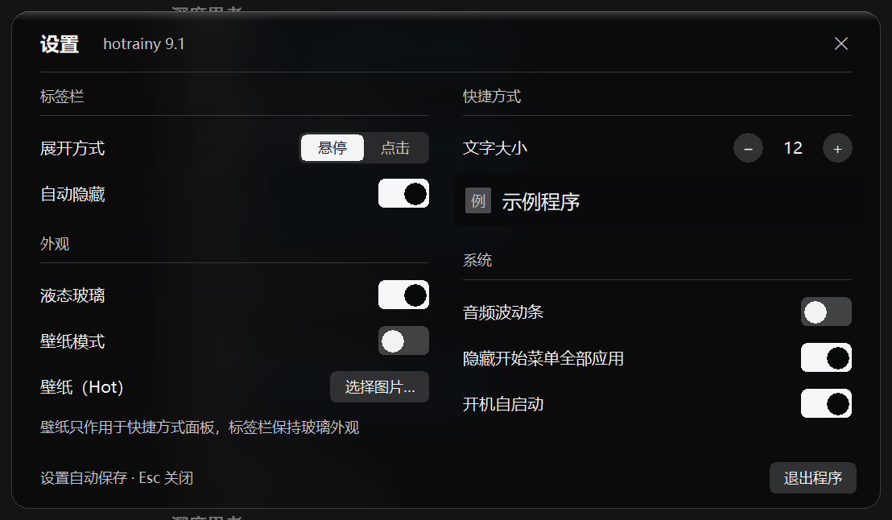

# hotrainy

**给 Windows 11 任务栏做真透明 + 岛台面板 + 顶部标签栏 + 音频波动条** 的 C++ 桌面小工具。

纯 C++ / Win32 + GDI+ 手写，静态链接 CRT，**免安装运行库、免管理员、免注册表**（除了你自己打开"开机自启"时写一个当前用户的启动项）。

> 英文简介：A lightweight C++ (Win32 + GDI+) toolkit for Windows 11 that makes the
> taskbar genuinely transparent, and adds a phone-style "island" launcher panel,
> a top edge tag bar, and an audio spectrum bar. Portable, no admin rights,
> no MSVC runtime needed (static CRT).

---

## 目录

- [功能一览](#功能一览)
- [截图](#截图)
- [下载与安装](#下载与安装)
- [使用方法](#使用方法)
- [从源码构建](#从源码构建)
- [目录结构](#目录结构)
- [实现原理（简述）](#实现原理简述)
- [常见问题](#常见问题)
- [许可与原创性](#许可与原创性)

---

## 功能一览

| 模块 | 说明 |
|---|---|
| **任务栏透明** | 注入 explorer，把 Win11 XAML 任务栏里的 `BackgroundFill` 隐藏掉，做到"真透明"（背景真的透出壁纸，而不是加一层半透明色块）。可单独开关"开始/搜索按钮"的处理。 |
| **岛台面板** | 在系统任务栏里放一个字母 **H** 的按钮，点开是一个仿手机桌面的快捷方式面板：内嵌搜索框、分类栏、大图标、长按拖拽排序、拖四角缩放、位置和尺寸自动记忆。 |
| **顶部标签栏** | 鼠标移到屏幕上边缘唤出，按标签分组显示桌面快捷方式；支持悬停/点击两种展开模式、右键增删改标签、每标签独立壁纸、滚轮翻页、面板内搜索。**全屏游戏/全屏视频时不弹出。** |
| **音频波动条** | 随系统响度起伏的频谱条（读取 `IAudioMeterInformation` 峰值）。可调横向/纵向长度、四种波动方向（上/下/左/右），鼠标拖本体即可移动，位置与尺寸持久化；层级为普通窗口（不置顶，不会挡住其他软件）。 |

### 细节特性

- 面板/标签栏/音频条都是**分层窗口**（`UpdateLayeredWindow` + `ULW_ALPHA`），支持真正的逐像素透明与圆角。
- 液态玻璃外观：抓取窗口背后画面 → 模糊 + 压暗烘焙，得到"背景越亮玻璃越深"的稳定观感。
- 托盘常驻，无主窗口；配置为单个 JSON：`%APPDATA%\hotrainy\config.json`。
- 支持多显示器、单实例、explorer 重启后自动重新注入、崩溃守护（`crashguard`）。

---

## 截图



---

## 下载与安装

### 方式一：单文件安装程序（推荐）

1. 下载 Releases 里的 **`hotrainy_setup.zip`**，解压得到 `hotrainy_installer.exe`。
2. 双击它 → 弹出系统文件夹选择框 → **选择安装位置** → 确认。
3. 安装程序会把程序文件解压到你选的文件夹，并创建**桌面快捷方式**和**开始菜单项**。
4. 装完可以选择立即启动。

- 免管理员、免运行库，装的是当前用户目录，不写系统目录。
- 安装程序**不会**改动开机自启；想开机启动，在程序设置里打开「开机自启动」。
- 卸载：运行安装目录里的 `uninstall.cmd`（见下）。

### 方式二：绿色版

解压后直接双击 `hotrainy.exe` 即可使用（`hotrainy.exe`、`GlassTAP.dll`、`GlassBoot.dll` 三个文件必须放在同一目录）。

### 卸载

运行安装目录（或解压目录）里的 **`uninstall.cmd`**，输入 `Y` 回车。它会：

1. 结束 hotrainy 进程
2. 删除开机自启项、桌面/开始菜单快捷方式
3. **重启一次资源管理器**（任务栏会闪一下）—— 这是必须的，因为 `GlassTAP.dll` / `GlassBoot.dll` 注入在 explorer 里，不重启释放不了，文件会提示"正在使用"删不掉
4. 删除程序文件
5. 删除配置、日志、标签壁纸（`%APPDATA%\hotrainy`、`%LOCALAPPDATA%\hotrainy`）
6. 校验残留并报告；脚本最后会删除自己

如果提示仍有残留（极少见），重启电脑后再运行一次即可。

---

## 使用方法

启动后**没有主窗口**，只会在托盘区出现图标。右键托盘图标 → **设置**，把要用的功能打开：

- `任务栏 → 透明`：任务栏变透明
- `任务栏 → 岛台`：任务栏上出现 **H** 按钮
- `系统 → 音频波动条`：显示频谱条

### 岛台面板

| 操作 | 说明 |
|---|---|
| 打开/收起 | 点任务栏上的 **H** 按钮 |
| 移动 | 按住面板最顶部那条窄边拖动 |
| 缩放 | 拖四个角（四条边不响应，避免误触） |
| 搜索 | 面板顶部搜索框，支持中文输入法 |
| 分类 | 左栏「全部」+ 每个标签一栏 |
| 排序 | 长按图标拖动 |
| 添加 | 面板空白处右键 → 添加快捷方式 |
| 底部 | 左下角用户按钮、右下角电源按钮 |

### 顶部标签栏

| 操作 | 说明 |
|---|---|
| 唤出 | 鼠标移到屏幕上边缘 |
| 展开方式 | 设置里切换「悬停展开 / 点击展开」（互斥） |
| 标签管理 | 标签上右键：添加标签 / 重命名 / 删除 / 左移 / 右移 / 设置此标签壁纸 |
| 每个标签一张壁纸 | 设置 → 外观 → **壁纸适用标签**（按标签 id 记忆，标签增删也不会错位） |
| 右侧图标 | 截图 / 回收站 / 此电脑 / 设置 |
| 搜索 | 默认 `Ctrl+Alt+Space`（可改），能搜快捷方式也能搜文件 |
| 全屏应用 | 检测到全屏游戏/视频时不弹出；常驻模式下会自动收起，退出全屏恢复 |

### 音频波动条

| 操作 | 说明 |
|---|---|
| 尺寸 | 设置 → 系统 → 「音频条横向长度 / 纵向长度」，点 +/−，**每下 50 像素**（不显示数字，直接看条的变化） |
| 初始尺寸 | 横向 = 屏宽÷6，纵向 = 屏高−8（都可再调） |
| 方向 | 「音频条波动方向」四选一：向上/向下（柱子横向排开、纵向起伏）、向左/向右（纵向排开、横向起伏）；**切换方向会自动对调宽高** |
| 移动 | 按住音频条本体拖动，松手即写入配置，下次启动记得 |
| 层级 | 普通窗口（不置顶），其他软件会盖住它 |

---

## 从源码构建

### 环境要求

- Windows 10 / 11
- Visual Studio 2022（Build Tools 即可）或更新的 MSVC
- CMake 3.20+ 与 Ninja（VS 自带）
- Windows SDK 10.0.22621 或更新

### 构建

```bat
:: 在 "x64 Native Tools Command Prompt for VS 2022" 里：
cd cpp\hotrainy
cmake -G Ninja -DCMAKE_BUILD_TYPE=Release -B build
cmake --build build -j4
```

产物：`build\hotrainy.exe`（主程序）、`build\GlassTAP.dll`、`build\GlassBoot.dll`。

> ⚠️ **改了头文件后请重新完整构建**（`ninja -t clean` 后再 build）。本项目曾因陈旧的 obj 布局出现过两次真实崩溃。

### 打包单文件安装程序

```bat
pack_installer.cmd
```

它会编译 `tools\installer\hr_installer.cpp`（安装程序 stub）→ 把 `dist_v3\` 里的程序文件作为载荷追加到 stub 末尾 → 输出 `hotrainy_installer.exe` 与 `hotrainy_setup.zip`。

---

## 目录结构

```
cpp/hotrainy/
├─ src/                     主程序源码（C++）
│  ├─ main.cpp              入口：状态机、设置应用、托盘
│  ├─ bar.cpp               顶部标签栏
│  ├─ panel.cpp             标签栏的悬停面板
│  ├─ island.cpp            岛台面板
│  ├─ islandbtn.cpp         任务栏上的 H 按钮
│  ├─ audio.cpp             音频波动条
│  ├─ glass.cpp             液态玻璃：抓屏、模糊、烘焙
│  ├─ search.cpp            搜索窗与索引
│  ├─ settings.cpp          设置窗
│  ├─ dialog.cpp            通用对话框（输入框、文件选择、提示）
│  ├─ menu.cpp              玻璃右键菜单
│  ├─ config.cpp            配置读写（%APPDATA%\hotrainy\config.json）
│  ├─ taskbar.cpp           任务栏服务：注入、状态机
│  └─ tb/xaml/              注入侧（GlassTAP / GlassBoot）
│     ├─ injector.cpp       查任务栏窗口、注入
│     ├─ tapsite.cpp        explorer 内的处理端
│     ├─ visualtree.cpp     XAML 视觉树访问（BackgroundFill 等）
│     ├─ channel.cpp        主程序 ↔ 注入侧的通信
│     ├─ glassboot.c        引导 DLL（纯 C，无 COM）
│     └─ crashguard.c       崩溃守护
├─ include/hr/              对应头文件
├─ res/                     图标等资源
├─ tap/                     tap 侧导出定义
├─ docs/                    实现笔记（含大量踩坑记录）
│  ├─ 任务栏透明实现说明.md
│  ├─ 岛台注入任务栏实现记录.md
│  ├─ 构建与自测.md
│  └─ 许可证与原创性说明.md
├─ tools/installer/         单文件安装程序源码
│  └─ hr_installer.cpp
├─ screenshots/             截图
├─ CMakeLists.txt
└─ LICENSE
```

---

## 实现原理（简述）

### 任务栏真透明

Win11 的任务栏是 XAML 做的：`Shell_TrayWnd` 里承载一棵 XAML 视觉树，任务栏的底色是树中名为
**`BackgroundFill`** 的 `Rectangle`。做法是：

1. 用 `SetWindowsHookEx` 把 `GlassBoot.dll` 注入 `explorer.exe`；
2. 在 explorer 内用 `InitializeXamlDiagnosticsEx` 拿到 XAML 诊断接口，遍历视觉树找到 `BackgroundFill`；
3. 把它的填充改成透明 / 需要时还原。

**为什么不用 `SetWindowCompositionAttribute` + `ACCENT_ENABLE_BLURBEHIND`？**
那是 Win10 时代对经典任务栏有效的做法；Win11 的任务栏内容由 XAML 绘制，accent 只作用在合成层的窗口背景上，
改出来的是一层"半透明色块"而不是真透明，透不出壁纸细节。

### 液态玻璃

`glass.cpp` 用 `BitBlt`（含 `CAPTUREBLT`）抓窗口背后的屏幕区域 → 降采样 → 多次盒式模糊 → 按背景亮度压暗烘焙成位图，
再作为分层窗口的内容。抓屏时避开自己（否则会抓到自己，出现"越叠越亮"的自反馈）。

### 分层窗口的几个坑（都踩过）

- `UpdateLayeredWindow` 的 `pptDst` 是**屏幕坐标并且会移动窗口** —— 传 `{0,0}` 会把窗口拽到左上角。
- `ShowWindow(SW_HIDE)` 之后再 `SW_SHOW`，分层窗口的 surface 不会自动恢复，必须销毁重建。
- 窗口的 `WM_SETCURSOR` 里手写光标形状，会让"鼠标移到边框"时光标变化 —— 用 `WM_NCCALCSIZE` 返回 0 让非客户区为 0 才是正解。
- 拖动过程（`WM_ENTERSIZEMOVE`）里不要去抓屏/隐藏窗口，否则会频闪。

更多实现细节和踩坑记录见 [`docs/`](docs/)。

---

## 常见问题

**Q：任务栏透明没反应？**
确认是 Windows 11；在设置里把「透明」关掉再打开一次（会重新注入 explorer）。个别系统版本或第三方任务栏美化工具（如 RoundedTB、ExplorerPatcher）会冲突。

**Q：岛台按钮没出现？**
在设置里开关一次「岛台」，程序会重启 explorer 并重新注入。

**Q：音频条看不见？**
设置里关掉再打开一次「音频波动条」。尺寸被调得过大时程序会自动夹到屏幕范围内。

**Q：卸载时提示文件正在使用？**
那是 `GlassTAP.dll` / `GlassBoot.dll` 还注在 explorer 里。用 `uninstall.cmd`（它会重启 explorer 释放），或手动重启 explorer / 重启电脑后再删。

**Q：点面板里的快捷方式没反应？**
程序会用"目标自身目录"作为工作目录启动（Electron、游戏启动器这类必须在自身目录启动），并在启动后尝试把目标窗口拉到前台。若个别程序仍打不开，多半是该程序自身需要提权或需要它自己的启动器。

**Q：日志在哪？**
主程序：`%APPDATA%\hotrainy\cpp.log`；注入侧：`%LOCALAPPDATA%\hotrainy\{tap,boot,crash}.log`。

---

## 许可与原创性

本项目以 **MIT License** 发布（见 [LICENSE](LICENSE)）。

关于任务栏透明这个功能，业界最知名的实现是 **TranslucentTB**（GPL-3.0）。我们在开发过程中**阅读过它的源码**用于理解技术原理，
但：

- **代码全部原创**，没有复制、粘贴或改写它的任何实现；
- 只使用了**不受版权保护的事实性技术知识**（例如某个 Windows SDK 公开 API 的存在与用法、任务栏背景在 XAML 树中的节点名）；
- 项目里没有引入任何 GPL 代码，因此可以按 MIT 发布。

详细说明见 [`docs/许可证与原创性说明.md`](docs/许可证与原创性说明.md)。

### 第三方

- 图标：使用 Windows 系统自带的 **Segoe Fluent Icons** 字体字形，不附带任何第三方图标文件。
- 依赖：仅 Windows 系统库（user32 / gdi32 / dwmapi / shell32 / ole32 / shlwapi / wtsapi32 等）。

---

## 致谢

- TranslucentTB —— 任务栏透明方向的先行者，本项目从中了解到该功能的技术可行性。
- Microsoft 的 `xamlOM.h` / XAML Diagnostics API 文档。